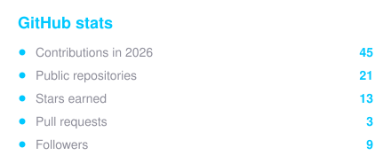
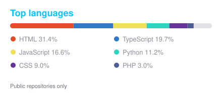
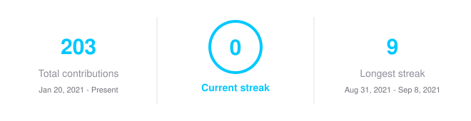
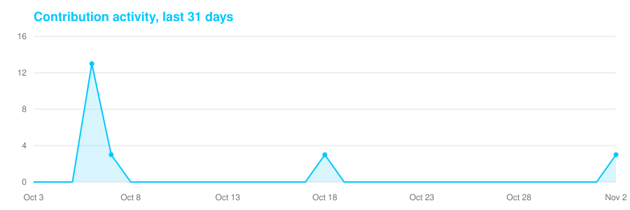

<!--
  GitHub profile README — redesigned to match the Acesso Digital theme (dark + cyan #00C8FF).
  All images live in assets/. Only the profile-views counter is external, because it counts visits as they happen.
  Paste this into your Zakaria-Bhaibi/Zakaria-Bhaibi repo README.md.
-->

<!-- ============ HEADER BANNER ============ -->

<!-- ============ ANIMATED TYPING ============ -->

 

<!-- ============ STATS BADGES ============ -->

<!-- ============ ABOUT ============ -->
##  About me

I'm a **software engineer** from Morocco, and coding has been my passion since I was young. I build modern web experiences and help businesses get found online through SEO, GEO and AEO.

-  &nbsp;Based in **Morocco**, working with clients worldwide
-  &nbsp;Portfolio → **[zakariabhaibi.com](https://www.zakariabhaibi.com/)**
-  &nbsp;Founder of **[Acesso Digital](https://acessodigitalma.com)** — web design, SEO/GEO/AEO & schema
-  &nbsp;Reach me at **[bhaibizakaria@gmail.com](mailto:bhaibizakaria@gmail.com)**
-  &nbsp;Always learning new skills to make the journey more exciting
-  &nbsp;Open to collaborating on interesting projects

 

<!-- ============ LANGUAGES ============ -->
##  Languages

  &nbsp;&nbsp;
  &nbsp;&nbsp;
  &nbsp;&nbsp;
  

 

<!-- ============ SKILLS (themed shields) ============ -->
##  Tech stack

**Languages**

**Frontend**

**Backend & Databases**

**CMS & E-commerce**

**Hosting & DevOps**

**AI, Automation & SEO**

**Tools & Design**

 

<!-- ============ SOCIALS (themed shields) ============ -->
##  Connect

  
  
  
  

 

<!-- ============ GITHUB STATS: stats, languages and activity are drawn daily by .github/workflows/stats.yml ============ -->
##  GitHub stats

  

  

 

<!-- ============ CERTIFICATES (unchanged — links to your repo assets) ============ -->
##  Certificates

<table>
   <tr height="320px">
      <!-- start item -->
      <td>
         <table>
            <tr>
               <td colspan="4">
               </td>
            </tr>
            <tr />
            <tr>
               <td width="220px" height="110px" vertical-align="top" colspan="4">
                <a href="https://www.coursera.org/account/accomplishments/verify/CTUDF6LJD5P0"><strong>How computers work</strong></a>, awarded for completing a course.
               </td>
            </tr>
            <tr />
            <tr>
               <td align="center">
                  <a href="https://www.coursera.org/account/accomplishments/verify/CTUDF6LJD5P0">
                     <picture>
                        <source media="(prefers-color-scheme: light)" srcset="./docs/assets/icons/icon-demo-light.svg" />
                        <source media="(prefers-color-scheme: dark)" srcset="./docs/assets/icons/icon-demo-dark.svg" />
                        
                     </picture>
                  </a>
               </td>
               <td align="center">
                  <a href="https://www.coursera.org/account/accomplishments/verify/CTUDF6LJD5P0">
                     <picture>
                        <source media="(prefers-color-scheme: light)" srcset="./docs/assets/icons/icon-pdf-light.svg" />
                        <source media="(prefers-color-scheme: dark)" srcset="./docs/assets/icons/icon-pdf-dark.svg" />
                        
                     </picture>
                  </a>
               </td>
               <td align="center">
                  <a href="https://www.coursera.org/account/accomplishments/verify/CTUDF6LJD5P0">
                     <picture>
                        <source media="(prefers-color-scheme: light)" srcset="./docs/assets/icons/icon-github-light.svg" />
                        <source media="(prefers-color-scheme: dark)" srcset="./docs/assets/icons/icon-github-dark.svg" />
                        
                     </picture>
                  </a>
               </td>
            </tr>
         </table>
      </td>
      <!-- end item -->
      <!-- start item -->
      <td>
         <table>
            <tr>
               <td colspan="4">
               </td>
            </tr>
            <tr />
            <tr>
               <td width="220px" height="110px" vertical-align="top" colspan="4">
                <a href="https://www.coursera.org/account/accomplishments/verify/UQ1ZHC7ZH48D"><strong>Introduction to Computer Programming</strong></a>, awarded for completing a course.
               </td>
            </tr>
            <tr />
            <tr>
               <td align="center">
                  <a href="https://www.coursera.org/account/accomplishments/verify/UQ1ZHC7ZH48D">
                     <picture>
                        <source media="(prefers-color-scheme: light)" srcset="./docs/assets/icons/icon-demo-light.svg" />
                        <source media="(prefers-color-scheme: dark)" srcset="./docs/assets/icons/icon-demo-dark.svg" />
                        
                     </picture>
                  </a>
               </td>
               <td align="center">
                  <a href="https://www.coursera.org/account/accomplishments/verify/UQ1ZHC7ZH48D">
                     <picture>
                        <source media="(prefers-color-scheme: light)" srcset="./docs/assets/icons/icon-pdf-light.svg" />
                        <source media="(prefers-color-scheme: dark)" srcset="./docs/assets/icons/icon-pdf-dark.svg" />
                        
                     </picture>
                  </a>
               </td>
               <td align="center">
                  <a href="https://www.coursera.org/account/accomplishments/verify/UQ1ZHC7ZH48D">
                     <picture>
                        <source media="(prefers-color-scheme: light)" srcset="./docs/assets/icons/icon-github-light.svg" />
                        <source media="(prefers-color-scheme: dark)" srcset="./docs/assets/icons/icon-github-dark.svg" />
                        
                     </picture>
                  </a>
               </td>
            </tr>
         </table>
      </td>
      <!-- end item -->
      <!-- start item -->
      <td>
         <table>
            <tr>
               <td colspan="4">
               </td>
            </tr>
            <tr />
            <tr>
               <td width="220px" height="110px" vertical-align="top" colspan="4">
                <a href="https://www.coursera.org/account/accomplishments/verify/QVKW4G23YD6U"><strong>Getting Started with Git and GitHub</strong></a>, awarded for completing a course.
               </td>
            </tr>
            <tr />
            <tr>
               <td align="center">
                  <a href="https://www.coursera.org/account/accomplishments/verify/QVKW4G23YD6U">
                     <picture>
                        <source media="(prefers-color-scheme: light)" srcset="./docs/assets/icons/icon-demo-light.svg" />
                        <source media="(prefers-color-scheme: dark)" srcset="./docs/assets/icons/icon-demo-dark.svg" />
                        
                     </picture>
                  </a>
               </td>
               <td align="center">
                  <a href="https://www.coursera.org/account/accomplishments/verify/QVKW4G23YD6U">
                     <picture>
                        <source media="(prefers-color-scheme: light)" srcset="./docs/assets/icons/icon-pdf-light.svg" />
                        <source media="(prefers-color-scheme: dark)" srcset="./docs/assets/icons/icon-pdf-dark.svg" />
                        
                     </picture>
                  </a>
               </td>
               <td align="center">
                  <a href="https://www.coursera.org/account/accomplishments/verify/QVKW4G23YD6U">
                     <picture>
                        <source media="(prefers-color-scheme: light)" srcset="./docs/assets/icons/icon-github-light.svg" />
                        <source media="(prefers-color-scheme: dark)" srcset="./docs/assets/icons/icon-github-dark.svg" />
                        
                     </picture>
                  </a>
               </td>
            </tr>
         </table>
      </td>
      <!-- end item -->
   </tr>
</table>
<table>
   <tr height="320px">
      <!-- start item -->
      <td>
         <table>
            <tr>
               <td colspan="4">
               </td>
            </tr>
            <tr />
            <tr>
               <td width="220px" height="110px" vertical-align="top" colspan="4">
                <a href="https://www.coursera.org/account/accomplishments/verify/CYUXEBFD8WCW"><strong>Introduction to Cloud Computing</strong></a>, awarded for completing a course.
               </td>
            </tr>
            <tr />
            <tr>
               <td align="center">
                  <a href="https://www.coursera.org/account/accomplishments/verify/CYUXEBFD8WCW">
                     <picture>
                        <source media="(prefers-color-scheme: light)" srcset="./docs/assets/icons/icon-demo-light.svg" />
                        <source media="(prefers-color-scheme: dark)" srcset="./docs/assets/icons/icon-demo-dark.svg" />
                        
                     </picture>
                  </a>
               </td>
               <td align="center">
                  <a href="https://www.coursera.org/account/accomplishments/verify/CYUXEBFD8WCW">
                     <picture>
                        <source media="(prefers-color-scheme: light)" srcset="./docs/assets/icons/icon-pdf-light.svg" />
                        <source media="(prefers-color-scheme: dark)" srcset="./docs/assets/icons/icon-pdf-dark.svg" />
                        
                     </picture>
                  </a>
               </td>
               <td align="center">
                  <a href="https://www.coursera.org/account/accomplishments/verify/CYUXEBFD8WCW">
                     <picture>
                        <source media="(prefers-color-scheme: light)" srcset="./docs/assets/icons/icon-github-light.svg" />
                        <source media="(prefers-color-scheme: dark)" srcset="./docs/assets/icons/icon-github-dark.svg" />
                        
                     </picture>
                  </a>
               </td>
            </tr>
         </table>
      </td>
      <!-- end item -->
      <!-- start item -->
      <td>
         <table>
            <tr>
               <td colspan="4">
               </td>
            </tr>
            <tr />
            <tr>
               <td width="220px" height="110px" vertical-align="top" colspan="4">
                <a href="https://www.coursera.org/account/accomplishments/verify/FFTN6Y4U2CYT"><strong>Introduction to Web Development with HTML, CSS, JavaScript
</strong></a>, awarded for completing a course.
               </td>
            </tr>
            <tr />
            <tr>
               <td align="center">
                  <a href="https://www.coursera.org/account/accomplishments/verify/FFTN6Y4U2CYT">
                     <picture>
                        <source media="(prefers-color-scheme: light)" srcset="./docs/assets/icons/icon-demo-light.svg" />
                        <source media="(prefers-color-scheme: dark)" srcset="./docs/assets/icons/icon-demo-dark.svg" />
                        
                     </picture>
                  </a>
               </td>
               <td align="center">
                  <a href="https://www.coursera.org/account/accomplishments/verify/FFTN6Y4U2CYT">
                     <picture>
                        <source media="(prefers-color-scheme: light)" srcset="./docs/assets/icons/icon-pdf-light.svg" />
                        <source media="(prefers-color-scheme: dark)" srcset="./docs/assets/icons/icon-pdf-dark.svg" />
                        
                     </picture>
                  </a>
               </td>
               <td align="center">
                  <a href="https://www.coursera.org/account/accomplishments/verify/FFTN6Y4U2CYT">
                     <picture>
                        <source media="(prefers-color-scheme: light)" srcset="./docs/assets/icons/icon-github-light.svg" />
                        <source media="(prefers-color-scheme: dark)" srcset="./docs/assets/icons/icon-github-dark.svg" />
                        
                     </picture>
                  </a>
               </td>
            </tr>
         </table>
      </td>
      <!-- end item -->

   </tr>
</table>

<!-- ============ FOOTER BANNER ============ -->

